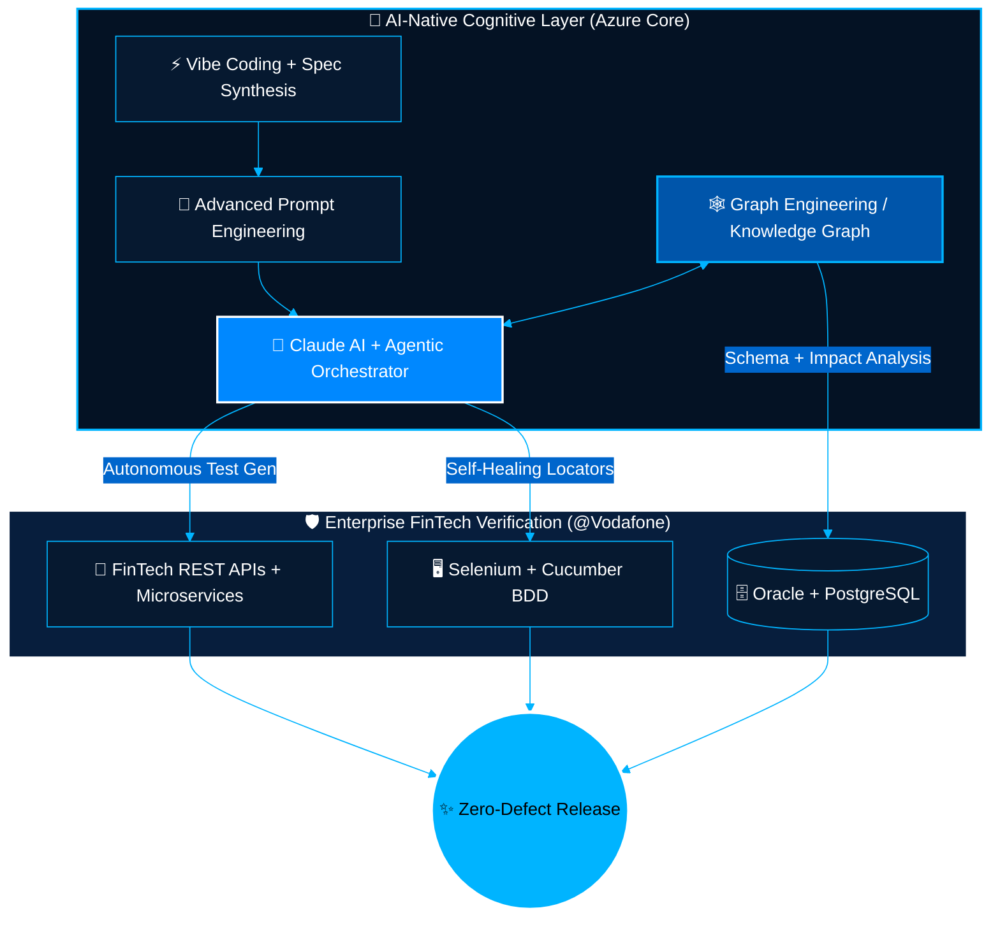

<div align="center">

<!-- 🟦 East Turkistan Sky-Blue Wave Banner & Crescent Star Aesthetic (XML-Safe Fixed) -->


<!-- ⚡ Animated Cyber-Blue Typing SVG (XML-Safe Fixed) -->
<a href="https://github.com/Uycoder">
  
</a>

<!-- 🛡️ Sky-Blue & White Prestige Badges -->
<p align="center">
  
  <a href="https://www.vodafone.com.tr/" target="_blank">
    
  </a>
  <a href="https://www.anthropic.com/" target="_blank">
    
  </a>
  
</p>

</div>

---

### 🌌 Executive Paradigm: Next-Gen AI × Quality Engineering

> **"Synthesizing deterministic FinTech Quality Engineering with autonomous Agentic AI, Graph-driven intelligence, and high-velocity Vibe Coding."**

I am **Ahmed Bughra**, a **Senior Software Development Engineer in Test (SDET)** with **5+ years of enterprise experience**, currently safeguarding high-concurrency **Mobile Financial Services (FinTech) at Vodafone**. Beyond traditional UI and Backend API automation, I pioneer **AI-Native Engineering**—leveraging **Claude AI**, **Multi-Agent Orchestration**, **Prompt Engineering**, and **Graph Engineering** to build self-healing verification architectures and ultra-fast software delivery pipelines.

```yaml
# ═══════════════════════════════════════════════════════════════════════════
# 🌙 SYSTEM TELEMETRY :: AHMED_BUGHRA_CORE_CONFIG.YAML
# ═══════════════════════════════════════════════════════════════════════════
engineer:
  name: "Ahmed Bughra"
  handle: "@Uycoder"
  role: "Senior SDET & AI-Native Systems Engineer"
  enterprise_domain: "Vodafone — Mobile Financial Services (FinTech)"
  aesthetic_protocol: "Kök Bayraq (Azure Sky #0099FF & Pure White #FFFFFF)"

ai_frontier_capabilities:
  agentic_ai: "Autonomous Multi-Agent Workflows, Tool-Use Orchestration & Self-Healing QA Agents"
  claude_ecosystem: "Claude 3.5/3.7 Sonnet, Claude Code CLI, Model Context Protocol (MCP) Integration"
  vibe_coding: "High-Velocity AI-Augmented Architecture, Rapid Spec-to-Production Synthesis"
  prompt_engineering: "System Prompt Architecture, Chain-of-Thought (CoT), Few-Shot & Deterministic Eval"
  graph_engineering: "Knowledge Graphs, GraphRAG, Dependency Topology & AST Code-Graph Analysis"

classic_engineering_pillars:
  test_automation: ["REST/SOAP API Verification", "Selenium WebDriver", "Cucumber BDD", "Postman"]
  backend_and_data: ["Java", "Spring Boot", "Hibernate ORM", "Oracle DB", "PostgreSQL"]
  cloud_and_devops: ["AWS", "Docker Containers", "Jenkins CI/CD", "Linux", "Git"]
```

---

### 🧠 Autonomous Agentic AI & Graph-Driven QA Topology

By combining **Graph Engineering** (mapping API topologies and microservice dependencies) with **Claude-powered Agentic AI**, my workflow transforms static test suites into living, cognitive quality gates:



---

### ⚡ Full-Spectrum Technical Arsenal

<div align="center">

| Domain | Core Technologies & Paradigms |
| :--- | :--- |
| **🤖 AI, Agents & Graph** |      |
| **🧪 Test Automation & QA** |     |
| **☕ Backend & Languages** |      |
| **☁️ DevOps, Cloud & Infra** |       |
| **🗄️ Data & Persistence** |    |

</div>

---

### 🔬 Deep-Dive: My 5 AI Engineering Pillars

```diff
+ [01] CLAUDE AI & MCP ARCHITECTURE
  Utilizing Claude models, Extended Thinking, and Model Context Protocol (MCP) to inspect API payloads,
  synthesize edge-case financial test scenarios, and perform automated root-cause analysis.

+ [02] AGENTIC AI ORCHESTRATION
  Building multi-agent pipelines where specialized agents autonomously plan, execute, validate,
  and self-heal API & UI test suites across distributed FinTech environments.

+ [03] VIBE CODING (AI-AUGMENTED VELOCITY)
  Translating high-level architectural intent into production-grade Java/Spring & automation codebases
  at 10x speed while maintaining strict static-analysis and enterprise security guardrails.

+ [04] SCIENTIFIC PROMPT ENGINEERING
  Designing deterministic, version-controlled system prompts using Chain-of-Thought (CoT), XML-structured
  context injection, and automated evaluation rubrics for zero-hallucination engineering outputs.

+ [05] GRAPH ENGINEERING & TOPOLOGY MAPPING
  Modeling complex microservice dependencies, API call-chains, and relational schemas as Knowledge Graphs
  to power GraphRAG and intelligent impact-based test selection.
```

---

### 📊 Live Telemetry & GitHub Matrix (Kök Bayraq Edition)

<div align="center">
  
  
</div>

<div align="center">
  
</div>

<div align="center">
  
</div>

---

### 🌐 Global Network & Collaboration

<div align="center">

[](https://www.linkedin.com/in/ahmed-bughra/)
[](https://github.com/Uycoder)
[](https://www.hackerrank.com/ahmedbughra)
[](https://stackoverflow.com/users/16111723/ahmad-ali)

<br/><br/>

<!-- 🟦 Footer Wave Banner (XML-Safe Fixed) -->


</div>
