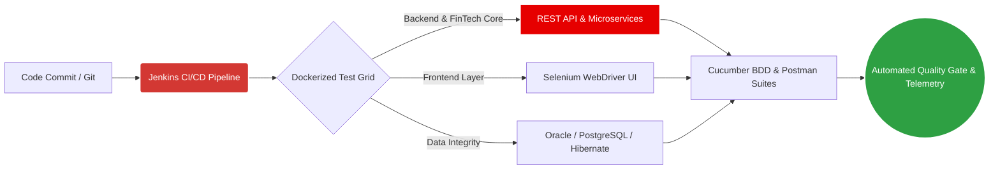

<div align="center">

<!-- Animated Typing Header -->
<a href="https://github.com/Uycoder">
  
</a>

<!-- Top Status & Social Badges -->
<p align="center">
  <a href="https://www.vodafone.com.tr/" target="_blank">
    
  </a>
  <a href="https://www.linkedin.com/in/ahmed-bughra/" target="_blank">
    
  </a>
  <a href="https://www.hackerrank.com/ahmedbughra" target="_blank">
    
  </a>
  <a href="https://stackoverflow.com/users/16111723/ahmad-ali" target="_blank">
    
  </a>
  
</p>

</div>

---

### 🧬 Executive Summary & Engineering Profile

I am a results-driven **Software Development Engineer in Test (SDET)** with **5+ years of specialized experience** in architecting, automating, and scaling high-reliability software verification systems. Currently spearheading API and backend quality engineering for **Mobile Financial Services (FinTech) at Vodafone**, I focus on ensuring zero-defect transactional integrity, microservice resilience, and continuous quality across enterprise architectures.

```yaml
engineer_profile:
  name: "Ahmed Bughra"
  role: "Software Development Engineer in Test (SDET)"
  organization: "Vodafone"
  domain: "Mobile Financial Services (FinTech) & Enterprise APIs"
  experience: "5+ Years in Quality Engineering & Test Automation"

core_competencies:
  test_architecture: ["End-to-End UI Automation", "RESTful & SOAP API Verification", "BDD Frameworks", "Contract & Integration Testing"]
  backend_engineering: ["Java", "Spring Ecosystem", "Hibernate ORM", "Relational Databases (Oracle, PostgreSQL)"]
  devops_and_cloud: ["CI/CD Pipelines (Jenkins)", "Docker Containerization", "AWS Cloud Infrastructure", "Linux Administration"]

current_focus:
  - "Designing scalable, fault-tolerant automated test suites for high-concurrency FinTech microservices"
  - "Advancing full-stack backend engineering capabilities with Java, Spring Boot, and cloud-native tools"
  - "Open-source knowledge sharing and technical collaboration within the global QA & Dev community"
```

---

### 🏛️ Automated Quality Assurance Architecture

My engineering methodology integrates **Shift-Left Testing** principles directly into the CI/CD lifecycle, combining behavior-driven specifications with multi-layered API, database, and UI verification:



---

### 🛠️ Technical Arsenal & Ecosystem

<div align="center">

| Category | Technologies & Tools |
| :--- | :--- |
| **Languages & Core** |     |
| **Test Automation & QA** |     |
| **Backend & Frameworks** |    |
| **DevOps, Cloud & OS** |      |
| **Databases** |   |

</div>

---

### 📊 GitHub Analytics & Engineering Telemetry

<div align="center">
  
  
</div>

<div align="center">
  
</div>

<div align="center">
  
</div>

---

### 🤝 Let's Connect & Collaborate

I am always open to discussing **Test Architecture, FinTech API Security & Reliability, Java/Spring Engineering, and Open-Source QA Frameworks**. Feel free to reach out across any of the platforms below:

<div align="center">

[](https://www.linkedin.com/in/ahmed-bughra/)
[](https://github.com/Uycoder)
[](https://www.hackerrank.com/ahmedbughra)
[](https://stackoverflow.com/users/16111723/ahmad-ali)

<br/>


</div>
