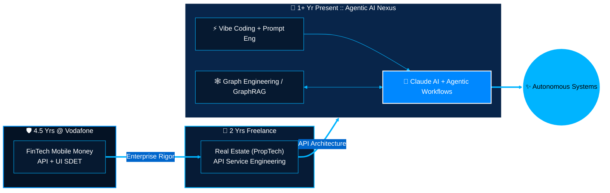

<div align="center">

<!-- 🟦 East Turkistan Sky-Blue Wave Banner & Crescent Star Aesthetic -->


<!-- ⚡ Animated Cyber-Blue Typing SVG (Zero-Clipping Fixed: Single-Line Cycling, Optimal Font & Width) -->
<a href="https://github.com/Uycoder">
  
</a>

<!-- 🛡️ Sky-Blue & White Prestige Badges -->
<p align="center">
  
  <a href="https://www.anthropic.com/" target="_blank">
    
  </a>
  
  
</p>

</div>

---

### 🌌 Executive Paradigm: From Enterprise FinTech & PropTech to Agentic AI

> **"7.5+ years of engineering evolution: Forged in enterprise FinTech QA at Vodafone, scaled through PropTech API engineering, and now pioneering autonomous Agentic AI, Graph-driven intelligence, and high-velocity Vibe Coding."**

I am **Ahmed Bughra**, an **Agentic AI Engineer & Senior SDET / API Architect** with **7.5+ years of hands-on industry experience**:
- 🤖 **Agentic AI & Cognitive Systems (Last 1+ Year — Present):** Architecting autonomous multi-agent workflows, **Claude AI / MCP** ecosystems, **Scientific Prompt Engineering**, **Knowledge Graph / GraphRAG** topologies, and high-velocity **Vibe Coding** pipelines.
- 🏢 **Freelance Backend & API Engineer — Real Estate / PropTech (2 Years):** Engineered and automated scalable RESTful API services, data pipelines, and backend integrations for a Real Estate API service provider.
- 🛡️ **Software Development Engineer in Test (SDET) @ Vodafone (4.5 Years):** Spearheaded end-to-end API and UI test automation for high-concurrency **Mobile Financial Services (FinTech)**, ensuring zero-defect transactional reliability.

```yaml
# ═══════════════════════════════════════════════════════════════════════════
# 🌙 SYSTEM TELEMETRY :: AHMED_BUGHRA_CAREER_MATRIX.YAML
# ═══════════════════════════════════════════════════════════════════════════
engineer:
  name: "Ahmed Bughra"
  handle: "@Uycoder"
  total_experience: "7.5+ Years (FinTech + PropTech + Agentic AI)"
  aesthetic_protocol: "Kök Bayraq (Azure Sky #0099FF & Pure White #FFFFFF)"

career_trajectory:
  - era: "Present (1+ Year)"
    role: "Agentic AI & AI-Native Systems Engineer"
    focus: "Claude AI, Multi-Agent Orchestration, Vibe Coding, Prompt & Graph Engineering"
  - era: "Previous (2 Years)"
    role: "Freelance API & Automation Engineer (Real Estate / PropTech)"
    focus: "Real Estate API Services, Backend Microservices, Data & Integration Pipelines"
  - era: "Foundation (4.5 Years)"
    role: "Software Development Engineer in Test (SDET) @ Vodafone"
    focus: "Mobile Financial Services (FinTech), API & UI Test Automation Architecture"

ai_frontier_capabilities:
  agentic_ai: "Autonomous Multi-Agent Workflows, Tool-Use Orchestration & Self-Healing Systems"
  claude_ecosystem: "Claude Sonnet/Opus, Claude Code CLI, Model Context Protocol (MCP)"
  vibe_coding: "High-Velocity AI-Augmented Architecture, Rapid Spec-to-Production Synthesis"
  prompt_engineering: "Deterministic System Prompts, Chain-of-Thought (CoT) & Eval Rubrics"
  graph_engineering: "Knowledge Graphs, GraphRAG, API Topology & AST Dependency Mapping"
```

---

### 🧠 Career Evolution & Autonomous AI Architecture

My engineering journey connects battle-tested **FinTech & Real Estate API foundations** directly into an **AI-Native Cognitive Layer**:



---

### ⚡ Full-Spectrum Technical Arsenal

<div align="center">

| Domain | Core Technologies & Paradigms |
| :--- | :--- |
| **🤖 AI, Agents & Graph** |      |
| **☕ Backend & API Eng** |      |
| **🧪 Test Automation & QA** |      |
| **☁️ DevOps, Cloud & Infra** |       |
| **🗄️ Data & Persistence** |    |

</div>

---

### 🔬 Deep-Dive: My 5 AI Engineering Pillars

```diff
+ [01] CLAUDE AI & MCP ARCHITECTURE
  Leveraging Claude models, Extended Thinking, and Model Context Protocol (MCP) to connect LLMs
  directly with enterprise APIs, databases, and developer toolchains.

+ [02] AGENTIC AI ORCHESTRATION (1+ YEAR FOCUS)
  Designing autonomous multi-agent systems that plan, reason, execute API tool-calls, validate outputs,
  and self-heal complex software workflows without human intervention.

+ [03] VIBE CODING (AI-AUGMENTED VELOCITY)
  Translating domain architectures (FinTech & Real Estate APIs) into production-grade codebases at 10x speed
  while enforcing strict enterprise quality and testability standards.

+ [04] SCIENTIFIC PROMPT ENGINEERING
  Structuring deterministic system prompts using Chain-of-Thought (CoT), XML context schemas,
  and automated evaluation pipelines for zero-hallucination reliability.

+ [05] GRAPH ENGINEERING & TOPOLOGY MAPPING
  Modeling complex API call-chains, real-estate data entities, and microservice dependencies as
  Knowledge Graphs to power GraphRAG and intelligent system reasoning.
```

---

### 📊 Live Telemetry & GitHub Matrix (Kök Bayraq Edition)

<div align="center">
  
  
</div>

<div align="center">
  
</div>

<div align="center">
  
</div>

---

### 🌐 Global Network & Collaboration

<div align="center">

[](https://www.linkedin.com/in/ahmed-bughra/)
[](https://github.com/Uycoder)
[](https://www.hackerrank.com/ahmedbughra)
[](https://stackoverflow.com/users/16111723/ahmad-ali)

<br/><br/>

<!-- 🟦 Footer Wave Banner -->


</div>
