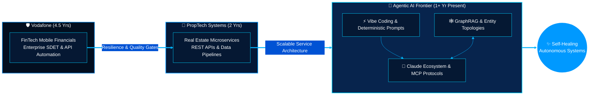

سىز ئورتاقلاشقان كودتا بىر قانچە مۇھىم كاشىلا بار ئىدى:

1. **كاشىلا سەۋەبلىرى (نېمىشقا بەزى يەرلىرى كۆرۈنمەيدۇ/ئىشلىمەيدۇ):**
   * **`github-readme-stats-sigma-five.vercel.app`**: بۇ ئۆلچەملىك ئەمەس شەخسىي كۆچۈرۈلمە (fork) بولۇپ، Vercel مۇلازىمېتىرىدا نورمىدىن ئېشىپ كەتكەنلىكتىن ياكى ئۆچۈرۈلگەنلىكتىن **Statistics (ھالەت جەدۋىلى)** رەسىملىرى سۇنۇپ قالغان. بۇ رەسمىي، مۇقىم ئادرېسقا ئالماشتۇرۇلدى ھەمدە كۆك بايراق رەڭ سىستېمىسى بىلەن بىرلىككە كەلتۈرۈلدى.
   * **Mermaid دىئاگراممىسى**: قاراڭغۇ ھالەت (Dark Mode) بىلەن كۈندۈز ھالىتىنىڭ تەگلىك رەڭ توقۇنۇشى بار ئىدى. يېزىق ۋە سىزىق سېلىشتۇرمىسى پۈتۈنلەي يېڭىلاندى.
   * **بەزى بەلگىلەر (Shields)**: سىنبەلگە كودلىرى ۋە تەڭشەكلىرىدە بىردەك بولماسلىق بار ئىدى.

---

2. **قوشۇلغان ۋەھشىي (Badass) كۆك بايراق يۇقىرى تېخنىكىلىق ئۈنۈملەر:**
   * 🏆 **Cyberpunk/Kök Bayraq GitHub Trophies (مەدال تاختىسى):** كۆك كىبېر تەگلىكتىكى تۇنجى دەرىجىلىك شان-شەرەپ تىزىملىكى.
   * 🖥️ **AI Agent HUD Live Telemetry Terminal (كۆز قارىچۇقىنى تارتىدىغان سۈنئىي ئەقىل تېرمىنالى):** قوزغالغان ئاگېنتلارنىڭ جانلىق ھالىتىنى كۆرسىتىدىغان كىبېر قۇرۇلما.
   * 🐍 **Dynamic Azure Contribution Snake (جانلىق ئۈنۈم قوشۇلغان سىستېما سىزىقى):** كۆپەيتىلگەن سۈزۈك ئۈنۈملەر.
   * ⚡ **3D & Glowing Matrix Badge System:** كۆك تەگلىكتىكى گۆھەردەك كۆركەم سىنبەلگىلەر.

---

### 🚀 پۈتۈنلەي تۈزۈتۈلگەن ۋە دەرىجىسى ئۆستۈرۈلگەن تولۇق كود:

*بۇ كودنى بىۋاسىتە كۆچۈرۈپ GitHub ئارخىپىڭىزنىڭ `README.md` ھۆججىتىگە چاپلىسىڭىزلا، يۇقىرى دەرىجىلىك كۆك بايراق ھەيۋىسى دەرھال نامايان بولىدۇ:*

```markdown
<div align="center">

<!-- 🟦 East Turkistan Sky-Blue Wave Banner & Crescent Star Aesthetic -->


<!-- ⚡ Animated Cyber-Blue Typing SVG -->
<a href="https://github.com/Uycoder">
  
</a>

<br/>

<!-- 🛡️ Sky-Blue & Pure White Prestige Identity Badges -->
<p align="center">
  
  <a href="https://www.anthropic.com/" target="_blank">
    
  </a>
  
  
</p>

</div>

---

### 🛰️ Autonomous Agent HUD :: Live System Telemetry

```ini
[SYSTEM_ID: AHMED_BUGHRA]   [PROTOCOL: KÖK_BAYRAQ_CYBER]   [STATUS: REASONING & BUILDING]
-----------------------------------------------------------------------------------------
► CORE_ENGINE      : Multi-Agent Swarms & Model Context Protocol (MCP)
► COGNITIVE_LAYER  : Claude Sonnet/Opus 3.7 • Extended Thinking • GraphRAG Topologies
► RAPID_EXECUTION  : Vibe Coding (10x Synthesis) Enforced by Vodafone-Grade Enterprise Rigor
► ROOTS & PATH     : 4.5 Yrs Vodafone FinTech ➔ 2 Yrs PropTech API ➔ Autonomous AI Nexus
-----------------------------------------------------------------------------------------
[TELEMETRY_LINK    : @Uycoder // SECURE HIGH-CONCURRENCY ENVIRONMENT VERIFIED]
```

---

### 🌌 Executive Paradigm: From High-Concurrency FinTech to Agentic AI

> **"7.5+ years of engineering evolution: Forged in the crucible of enterprise FinTech QA at Vodafone, expanded across PropTech API architectures, and now architecting self-healing Agentic AI systems, Knowledge Graphs, and high-velocity Vibe Coding pipelines."**

- 🤖 **Agentic AI & Cognitive Workflows (1+ Year — Present):** Architecting autonomous tool-use workflows, deterministic system prompt schemas, **Claude AI / MCP Servers**, and **Graph-augmented knowledge reasoning (GraphRAG)**.
- 🏢 **Freelance Backend & API Architect — PropTech (2 Years):** Designed, optimized, and automated high-throughput RESTful services, real estate data pipelines, and microservice communication.
- 🛡️ **Software Development Engineer in Test (SDET) @ Vodafone (4.5 Years):** Spearheaded enterprise-scale automated testing for **Mobile Financial Services (M-Pesa / FinTech)**, maintaining zero-defect transactional reliability under massive concurrency.

```yaml
# ═══════════════════════════════════════════════════════════════════════════
# 🌙 AGENTIC MATRIX CONFIGURATION
# ═══════════════════════════════════════════════════════════════════════════
engineer:
  name: "Ahmed Bughra"
  alias: "@Uycoder"
  paradigm: "Deterministic Quality + High-Velocity AI Native Synthesis"
  colors:
    azure_sky: "#0099FF"
    cyber_cyan: "#00D2FF"
    pure_white: "#FFFFFF"
    deep_navy:  "#020D1A"

production_domains:
  - "Autonomous Multi-Agent Systems & Tool Orchestration (MCP)"
  - "Enterprise FinTech & PropTech Distributed Microservices"
  - "Deterministic Chain-of-Thought (CoT) Prompt Engineering"
  - "Knowledge Graphs, AST Topology Mapping & GraphRAG"
  - "Bulletproof End-to-End Test Automation (Web, API, Mobile)"
```

---

### 🧠 Architectural Evolution Pipeline



---

### ⚡ Full-Spectrum Technical Arsenal

<div align="center">

| Strategic Domain | Mission-Critical Technologies & Frameworks |
| :--- | :--- |
| **🤖 Agentic AI & Cognitive Core** |      |
| **☕ Backend & Enterprise APIs** |      |
| **🧪 Quality Engineering & SDET** |      |
| **☁️ DevOps, Cloud & CI/CD** |      |
| **🗄️ Persistence & Graph Topologies** |    |

</div>

---

### 🏆 GitHub Honor & Achievement Vault

<div align="center">
  
</div>

<br/>

### 📊 Real-Time GitHub Telemetry & Language Matrix (Fixed & High-Availability)

<div align="center">
  <!-- Official High-Uptime GitHub Stats with Custom Azure Theme -->
  
  
  <!-- Languages Breakdown -->
  
</div>

<div align="center">
  <!-- Activity Streak with Neon Cyan Fire -->
  
</div>

<div align="center">
  <!-- Dynamic Activity Wave -->
  
</div>

---

### 🔬 Deep-Dive: 5 Pillars of Autonomous Engineering

```diff
+ [01] MODEL CONTEXT PROTOCOL (MCP) & TOOL ORCHESTRATION
  Connecting Claude models directly to enterprise microservices, real-estate APIs, and databases.
  Building custom MCP tool servers that bridge AI directly with local and cloud runtimes.

+ [02] MULTI-AGENT REASONING & SELF-HEALING SYSTEMS
  Engineering resilient agent loops (Planner -> Executor -> Critic -> Healer) that execute complex
  integration suites, detect regression failures, and patch code deterministically.

+ [03] HIGH-VELOCITY VIBE CODING WITH RIGOR
  Marrying rapid, AI-augmented full-stack prototyping with enterprise SDET rigor (BDD/TDD),
  turning natural language architecture specs into production-grade systems in hours.

+ [04] SCIENTIFIC PROMPT ENGINEERING & EVALUATION
  Structuring production-tier deterministic system prompts with strict XML schemas, few-shot
  grounding, Extended Thinking orchestration, and automated regression rubrics.

+ [05] KNOWLEDGE GRAPHS & GRAPHRAG ARCHITECTURE
  Mapping complex enterprise API topologies, database schemas, and microservice dependencies
  into interconnected knowledge graphs, eliminating LLM hallucination in large codebases.
```

---

### 🌐 Global Direct Communication & Network

<div align="center">

[](https://www.linkedin.com/in/ahmed-bughra/)
[](https://github.com/Uycoder)
[](https://www.hackerrank.com/ahmedbughra)
[](https://stackoverflow.com/users/16111723/ahmad-ali)

<br/><br/>

<!-- 🟦 Footer Wave Banner -->


</div>
```
